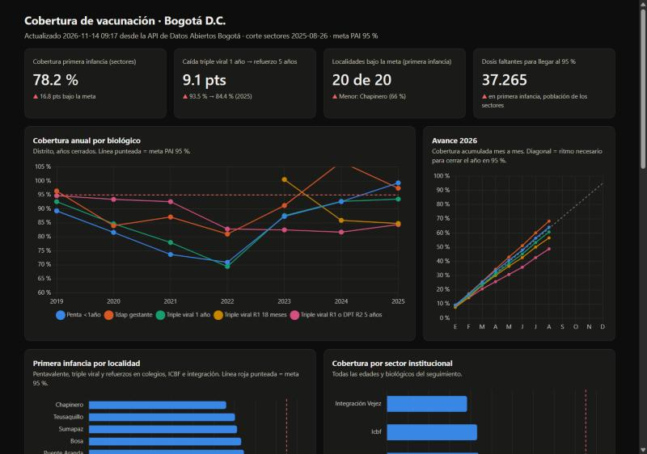
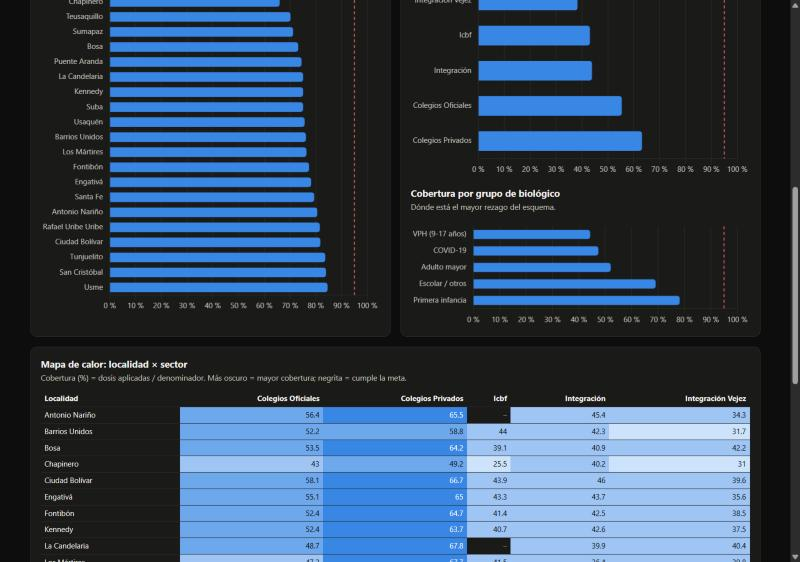
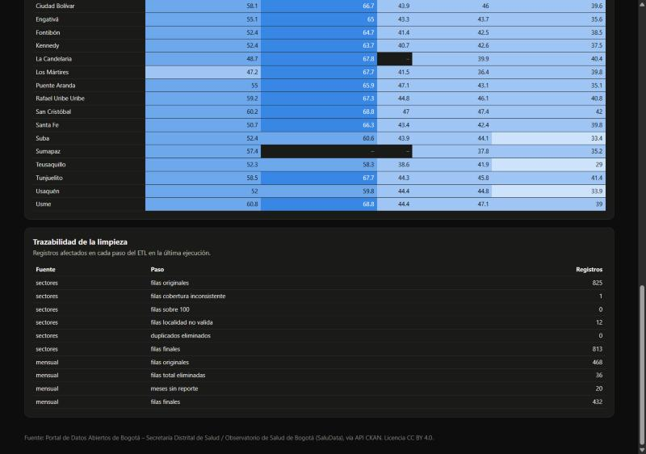
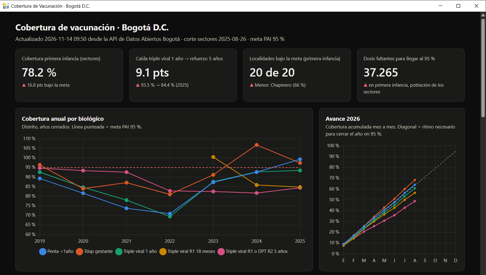
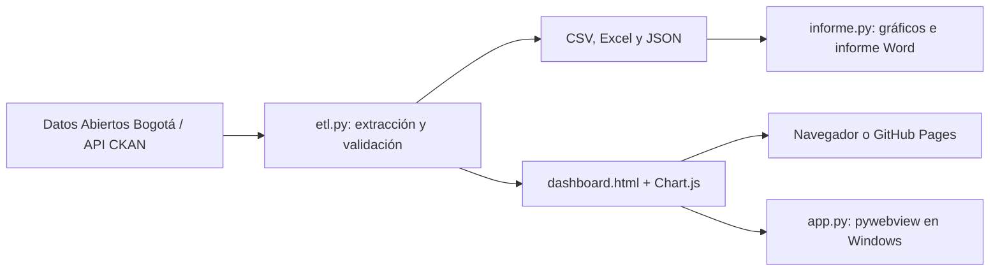

# 💉 Cobertura de Vacunación · Bogotá D.C.

**Dashboard de inteligencia de negocios para analizar coberturas de vacunación, diferencias territoriales e indicadores frente a la meta de referencia del 95 %.**

   

> **Universidad Manuela Beltrán · Inteligencia de Negocios.** Proyecto académico basado en fuentes públicas de la Secretaría Distrital de Salud / SaluData. Sus indicadores son para análisis y aprendizaje y no sustituyen los registros o decisiones oficiales de salud pública.

## 📌 Descripción

El proyecto consulta recursos de la **API CKAN del Portal de Datos Abiertos de Bogotá**, procesa la información mediante un flujo **ETL (extracción, transformación y carga)** y genera indicadores, tablas, gráficos, archivos analíticos y un dashboard HTML. También cuenta con una aplicación de escritorio para Windows y con automatización mediante GitHub Actions.

Busca responder:

- ¿Qué tan lejos se encuentran las coberturas observadas de la meta de referencia del **95 %**?
- ¿Qué localidades presentan mayores brechas en los datos institucionales?
- ¿Cómo varían los indicadores por biológico, periodo y sector institucional?
- ¿Cómo se comporta la cobertura de triple viral al año frente al refuerzo a los cinco años?
- ¿Qué validaciones y transformaciones se aplican antes de generar los resultados?

**Alcance implementado:** el código del repositorio utiliza fuentes de **Bogotá D.C.** y sus localidades. El análisis ampliado a otras regiones, como Cundinamarca, corresponde a la evolución propuesta del proyecto, no a una función implementada en este repositorio.

## ✅ Funcionalidades actuales

| Módulo | Funcionalidad |
|---|---|
| API y ETL | Consulta paginada de recursos CKAN, limpieza y normalización. |
| KPIs | Cobertura de primera infancia, localidades bajo meta, diferencia entre etapas y dosis adicionales estimadas. |
| Histórico | Evolución anual de cobertura por biológico en años completos. |
| Mensual | Avance del año disponible frente a una trayectoria de referencia. |
| Territorial | Comparación de cobertura de primera infancia por localidad. |
| Institucional | Comparación por institución y grupo de biológico. |
| Mapa de calor | Matriz localidad × sector institucional. |
| Calidad de datos | Log de transformación y controles de consistencia. |
| Archivos | Salidas CSV, Excel, JSON y HTML. |
| Informe | Gráficas PNG y documento Word generado a partir de las salidas. |
| Escritorio | Ventana local mediante `pywebview` y opción de empaquetado a `.exe`. |

## 🖼️ Capturas de pantalla







**Aplicación de escritorio:**



Las cifras mostradas en las capturas son evidencias de una ejecución: pueden cambiar cuando se actualicen las fuentes.

## 🧩 Arquitectura



| Tecnología | Uso |
|---|---|
| **Python** | Orquestación y lógica de procesamiento. |
| **pandas** | Limpieza, agregación y cálculos. |
| **openpyxl** | Creación del libro Excel. |
| **HTML/CSS/JavaScript y Chart.js** | Interfaz y gráficos. |
| **pywebview** | Aplicación de escritorio. |
| **Matplotlib y python-docx** | Informe y gráficos académicos. |
| **PyInstaller** | Creación opcional del ejecutable. |
| **GitHub Actions / Pages** | Actualización y publicación automatizada. |

### Estructura del repositorio

```text
Proyecto_vacunacion/
├── .github/workflows/actualizar.yml   # ETL, pruebas y publicación
├── app.py                              # Ventana de escritorio
├── etl.py                              # Fuentes, ETL, KPIs y dashboard
├── informe.py                          # Gráficas e informe Word
├── test_etl.py                         # Pruebas de limpieza sin conexión
├── dashboard_template.html             # Interfaz HTML y gráficos
├── chart.umd.min.js                    # Chart.js incluido localmente
├── requirements.txt                    # Dependencias básicas
├── evidencias/                         # Capturas
├── graficas/                           # Gráficas para informe
├── Proyecto_Final_Cobertura_Vacunacion.docx
└── salidas/                             # Generados, ignorados por Git
```

## 🌐 Fuentes de datos

Las consultas utilizan el endpoint:

`https://datosabiertos.bogota.gov.co/api/3/action/datastore_search`

| Conjunto | Identificador CKAN |
|---|---|
| Seguimiento de cobertura de vacunación por sectores | `e519cce2-9951-41de-afbc-005d1e1d24dd` |
| Cobertura mensual de vacunación en Bogotá D.C. | `1910589c-2836-41d3-aba4-00488bb5e5f3` |

Ejemplo de consulta:

```text
https://datosabiertos.bogota.gov.co/api/3/action/datastore_search?resource_id=e519cce2-9951-41de-afbc-005d1e1d24dd&limit=5
```

La descarga requiere conexión a Internet y depende de la disponibilidad del servicio externo.

## 🚀 Instalación

**Requisitos:** Python (el workflow utiliza **3.12**), Git, conexión a Internet y permisos de escritura para generar `salidas/`.

### 1. Clonar y crear un entorno virtual

```bash
git clone https://github.com/julianpenuelaalfonso-fullstack/Proyecto_vacunacion.git
cd Proyecto_vacunacion
python -m venv .venv
```

**Windows PowerShell:**

```powershell
.\.venv\Scripts\Activate.ps1
```

**Linux/macOS:**

```bash
source .venv/bin/activate
```

### 2. Instalar dependencias básicas

```bash
python -m pip install -r requirements.txt
```

El archivo `requirements.txt` declara `pandas` y `openpyxl`. Otras herramientas se instalan por separado según el modo de uso.

### 3. Ejecutar las pruebas

```bash
python test_etl.py
```

Son pruebas locales de reglas de transformación que utilizan datos de ejemplo y no necesitan conectarse a la API. Si todas las aserciones pasan, muestran `OK`.

### 4. Ejecutar ETL y abrir el dashboard

```bash
python etl.py
```

Abre `salidas/dashboard.html` en un navegador moderno. Los gráficos usan Chart.js integrado en el HTML generado.

### 5. Generar el informe (opcional)

```bash
python -m pip install matplotlib python-docx
python informe.py
```

Ejecuta `etl.py` antes de `informe.py`: el segundo script necesita las salidas del primero.

## 📦 Archivos generados

| Archivo | Contenido |
|---|---|
| `salidas/crudo_sectores.csv` | Registros sectoriales originales. |
| `salidas/crudo_mensual.csv` | Registros mensuales originales. |
| `salidas/hechos_sectores.csv` | Datos sectoriales transformados. |
| `salidas/cobertura_anual.csv` | Cobertura anual por biológico. |
| `salidas/base_consolidada.xlsx` | Hojas de hechos, dimensiones, KPIs y limpieza. |
| `salidas/kpis.json` | Indicadores y log de transformación. |
| `salidas/dashboard.html` | Dashboard generado. |

La carpeta `salidas/` está excluida del control de versiones mediante `.gitignore`.

## 🖥️ Aplicación de escritorio (Windows)

`app.py` abre una ventana mediante **pywebview**, ejecuta el ETL y muestra el HTML generado en su propia interfaz.

Para ejecutar desde Python:

```bash
python -m pip install pywebview==5.3.2
python app.py
```

Para compilar un `.exe` **desde Windows**:

```powershell
python -m pip install pyinstaller pywebview==5.3.2
pyinstaller --onefile --windowed --name CoberturaVacunacion --add-data "dashboard_template.html;." --add-data "chart.umd.min.js;." app.py
```

El archivo resultante se ubica en `dist/CoberturaVacunacion.exe`. Actualmente `dist/` está ignorado por Git; el repositorio fuente no contiene necesariamente una compilación distribuida. La aplicación necesita Internet para obtener datos nuevos y depende del motor web disponible en Windows (habitualmente WebView2).

## 🔄 Automatización y publicación

El workflow [`.github/workflows/actualizar.yml`](.github/workflows/actualizar.yml) ejecuta las pruebas y el ETL con Python 3.12, prepara `index.html` y despliega `salidas/` a GitHub Pages.

**Disparadores configurados:**

- Diario a las **11:00 UTC** (06:00 hora de Colombia).
- En cada push a `main`.
- Manualmente mediante **Run workflow**.

Para usar Pages, configurar en GitHub **Settings → Pages → Source: GitHub Actions**. La publicación depende de la configuración y del resultado del workflow; no se presume que esté habilitada.

## 📐 Indicadores y calidad

**Cobertura administrativa**

```text
Cobertura (%) = (dosis aplicadas / denominador) × 100
```

**Brecha de cobertura**

```text
Brecha (puntos porcentuales) = 95 − cobertura (%)
```

El código también usa un rezago no negativo (`brecha_meta`) y un indicador de cumplimiento frente al 95 %. Los agregados sectoriales se calculan sumando numeradores y denominadores; no mediante un promedio simple de coberturas.

El ETL incluye normalización de nombres, conversión numérica, verificación de localidades, detección de duplicados, identificación de coberturas superiores al 100 %, contraste entre cobertura reportada y recalculada, y registro de meses sin información.

**Limitación metodológica:** comparar la cobertura de triple viral al año con la de refuerzo a los cinco años no prueba por sí mismo abandono individual, porque podrían referirse a cohortes distintas. Una cobertura administrativa superior al 100 % tampoco representa automáticamente un error de captura.

## 🗺️ Roadmap de evolución

Estas mejoras son **planificadas**, no funciones ya disponibles:

| Versión | Objetivo | Estado |
|---|---|---|
| **V1.0** | ETL, KPI, dashboard, informe y aplicación de escritorio. | Base implementada |
| **V1.1** | Rediseño UI/UX, componentes y navegación por módulos. | Planificada |
| **V1.2** | Filtros globales, comparaciones y exportaciones interactivas. | Planificada |
| **V1.3** | Mapas geográficos y fichas territoriales. | Planificada |
| **V1.4** | Calidad de datos, historial y auditoría ETL. | Planificada |
| **V1.5** | Accesibilidad, rendimiento, seguridad y pruebas. | Planificada |
| **V2.0** | Alertas, escenarios y priorización explicable. | Planificada |

## 🧪 Colaboración

Para contribuir: crea una rama, documenta los cambios, ejecuta las pruebas afectadas y abre un Pull Request. Se recomienda usar mensajes de commit descriptivos, por ejemplo:

```text
docs(readme): documenta arquitectura y ejecución
feat(ui): crea navegación por módulos
test(etl): amplía validaciones
```

No atribuir cambios a personas que no los realizaron; el historial de Git y las revisiones reflejan contribuciones verificables.

## 👥 Integrantes

**Universidad Manuela Beltrán** · **Inteligencia de Negocios** · **Docente: Juan José Osorio Tabares**

| Integrante | GitHub | Aportes descritos en el README original |
|---|---|---|
| **Julián Andrés Peñuela Alfonso** | [@julianpenuelaalfonso-fullstack](https://github.com/julianpenuelaalfonso-fullstack) | ETL, API, dashboard, aplicación de escritorio y repositorio. |
| **Valery Michell Herrera Roca** | [@Codeforgeettttt](https://github.com/Codeforgeettttt) | Informe, pruebas y entregas académicas previas. |
| **Daniel Felipe Rojas González** | [@Dani2026403](https://github.com/Dani2026403) | Informe, pruebas y entregas académicas previas. |

## 📚 Referencias y documentación

- [Informe académico](Proyecto_Final_Cobertura_Vacunacion.docx)
- [Evidencias de funcionamiento](evidencias/)
- [Gráficas del proyecto](graficas/)
- [Portal de Datos Abiertos de Bogotá](https://datosabiertos.bogota.gov.co/)
- [Secretaría Distrital de Salud](https://www.saludcapital.gov.co/)

---

*Proyecto académico de Inteligencia de Negocios. La vigencia y el alcance de los indicadores dependen de las fuentes oficiales utilizadas.*
